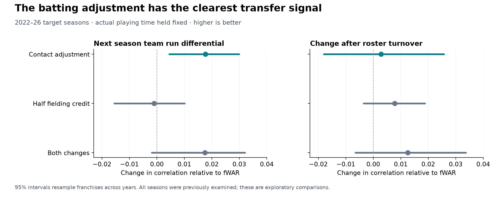

# DV WAR audit and improvement candidates

October 29, 2026

The strongest part of the project is its contact based batting measure. A candidate that adds that adjustment to fWAR while keeping published fielding and pitching unchanged improved the transfer of player credit to next season's team results. It is a promising research variant of WAR. A superior measure of past individual contribution is still unproved.

The case for cutting every fielder's runs in half is substantially weaker. That choice did not clearly improve season transfer, and a new fielding model produced mixed team results and noisier individual values. Retain full measured fielding as the main reference while investigating attribution and measurement error separately.

All evaluation seasons here have been examined in earlier work. The original v1 files, the prospective v2 specification, live projections and website values are unchanged. New code, aggregate results and an additional privately frozen candidate are saved alongside this report.

## What the current project measures

The existing system assigns a hitter all of his expected contact value and half the difference between the contact expectation and the outcome. It also halves measured fielding runs, excluding catcher framing. The original pitcher treatment assigns contact and sequencing credit; that treatment passed the half season test but failed the roster turnover test. The locked v2 hypothesis keeps the hitter settings and changes pitchers to FIP style treatment.

Two implementations matter. The split season study reconstructs fielding from pitch data and a rough responsibility rule. The season WAR table starts with published fWAR and modifies its batting and published fielding components. These are different fielding measurements. A gain in a batting only test cannot establish that the published fielding component should be halved.

## Separating the batting and fielding changes

Each player's prior season WAR rate is applied to his actual next season playing time. The resulting team totals are compared with official team run differential. This holds playing time fixed and tests transfer of credit; it is not a preseason forecast of playing time or wins. The five target seasons are 2022–26, giving 150 team seasons.

The roster turnover comparison instead uses the change in each player's playing time with each team and the change in official team run differential. Correlation is higher when the ranking of teams is better. Prediction error is root mean squared error in runs per game after calibration that excludes the target season; lower is better.

| WAR variant | Next season correlation | Next season error | Roster turnover correlation | Roster turnover error |
| --- | ---: | ---: | ---: | ---: |
| Published fWAR | 0.7265 | 0.5436 | 0.6099 | 0.5766 |
| Contact adjustment only | 0.7442 | 0.5277 | 0.6128 | 0.5751 |
| Half fielding credit only | 0.7255 | 0.5437 | 0.6177 | 0.5721 |
| Both hitter adjustments | 0.7440 | 0.5270 | 0.6225 | 0.5696 |

The contact adjustment alone lowers next season error by 2.9%. Its correlation improvement over fWAR is .0176, with a 95% interval of .0045 to .0299 when franchises are resampled across years. Resampling whole seasons gives .0001 to .0340. Halving fielding alone has no clear advantage. Combining both changes has a similar point estimate to the batting adjustment, with wider uncertainty.

None of the three hitter variants clearly beats fWAR in the roster turnover comparison under either resampling method. Controlling prior team run differential and predicting the next season with calibration fitted on other seasons also leaves a very small difference between the contact candidate and fWAR: .5253 versus .5260 runs per game. That check limits a claim of superior individual attribution.

The intervals are conditional on the fitted event models and these inputs. They do not include provider revisions, model fitting uncertainty or adjustment for trying several research variants.

## Contact adds information beyond ordinary regression

The first mover check compared the fixed contact blend with unadjusted past batting results. It reduced next season batting rate error by 7.1% overall and 5.1% among team changers, with improvement in every target year. That comparison gives the raw results too little help: ordinary regression toward average is itself useful.

A later diagnostic therefore fits two models using only the original four development pairs, 2016 to 2017, 2017 to 2018, 2018 to 2019 and 2019 to 2021. One calibrates past batting results with an intercept and slope. The other adds contact value. No 2022–26 target outcome is used to fit either calibration. This diagnostic was added after the initial result and is exploratory.

The outcome is next season batting runs above average per PA, weighted by target PA. Players need 200 PA in each season. Team changers are identified by a change in the team accounting for the largest share of their PA. Intervals resample players and retain their repeated seasons.

| Group | Player seasons | Results baseline error | Results plus contact error | Error reduction | 95% interval |
| --- | ---: | ---: | ---: | ---: | --- |
| All eligible hitters | 1,334 | 0.02592 | 0.02494 | 3.76% | 2.64% to 4.81% |
| Team changers | 314 | 0.02655 | 0.02603 | 1.97% | -0.01% to 3.90% |
| Players staying with their team | 1,020 | 0.02574 | 0.02463 | 4.29% | 2.94% to 5.56% |

The contact model improves every test year in all three groups. The smaller mover group does not quite separate the calibrated models statistically. The 50/50 value formula itself is a weaker forecasting model than the calibrated results baseline: it is 8.4% worse overall. Contact information is useful, but this does not make a fixed value formula a complete projection system or show an improvement over the site's existing DV projections.

## Half season tests and player identity

The reconstruction uses three fixed game splits in each of 2023–25, both directions, for 18 measured halves. These are three reused seasons, not 18 independent samples and not an exact replay of the original five season, ten split benchmark. The inputs combine a checksum verified historical archive, later local daily downloads, current sprint tables and complete local 2026 downloads.

On this subset, the FIP reference has run differential correlation .6961; the contact candidate with full fielding has .7078. For offense alone the correlations are .5669 and .5745. Replacing same season sprint speed with prior season speed leaves the contact offense correlation at .5724, so full season speed explains a small part, not the whole point estimate.

Shuffling rates among players on the same team within opportunity bins reduces the contact candidate's run differential correlation to a median .6570 across 100 permutations, versus .7078 with the real assignments. There is individual information. However, replacing each player's rate with the weighted average of his team and opportunity group retains correlation .6986; its offense correlation is .5840, above the individually assigned .5745. The half season test therefore contains substantial team and usage information. Passing it alone cannot establish that every player's credited WAR is correct.

## A different fielding model did not clear the checks

The new prototype estimates the chance that each position records an out from the contact, park and alignment. On a hit, it debits the fielders their estimated shares of the missed out instead of assigning one failed play to one chosen fielder. It uses four folds grouped by game, excludes home runs, never uses player identities in the event model and centers the resulting credits within position.

In the reconstructed framework it improved next season team correlation from .6926 to .7259. Its advantage is uncertain under both franchise and season resampling. Roster turnover correlation improved from .5851 to .6042, also inconclusively, and did not beat the locked v2 hybrid's .6095. On the three season split test it scored .7120, close to the simpler contact candidate's .7078.

A descriptive comparison with published noncatcher fielding reveals excessive variance. In 2024 its player fielding values had SD 9.7 runs against 4.9 for published fielding, with error 8.3 runs; the original reconstructed model had SD 6.9 and error 6.1. The new fielding error is larger in every checked year. Published fielding is a reference measurement, not individual ground truth, but these results do not support replacing it with this prototype. Public pitch data also lack the starting positions and tracking detail used by modern range metrics.

## Why fielding persistence is not a discount on past value

A run saved can have value even if the player does not save the same run next year. Low persistence can reflect measurement noise, true changes in skill, aging or changing opportunities. A future regression slope of roughly .5 does not identify how much of this season's measured fielding was real. Batting outcomes also regress substantially in the calibrated check.

The useful next distinction is between uncertain measurement of past performance and a forecast of future performance. A defensible adjustment to past fielding needs an estimate of measurement error and credit attribution, ideally using independent tracking information and opportunity. A forecast can shrink fielding much more directly, because persistence is part of its target.

For Rafaela specifically, the 2026 fWAR input is 4.14. The contact adjustment removes .65 WAR. Halving fielding removes another .59. Keeping full fielding would therefore produce 3.49 in this research variant, compared with 2.90 with both adjustments. These are estimates of the 2026 season, separate from his 2027–31 projections; those projections were not changed by this audit.

## Measurement checks

- All available v1 source files match the recorded original or explicitly recorded post lock hashes.
- Ten full seasons were reconstructed: 2016–19 and 2021–26. Source duplicate pitches are removed by game, PA and pitch number. Coverage and final game scores are checked against official standings.
- The Athletics name change is normalized before matching or differencing teams. All season comparisons contain 150 finite, unique team season rows.
- Official season RS and RA are the season targets. Half season targets use final game scores, avoiding lost runs in sums of completed PA events.
- Six executable checks cover FIP equivalence, isolation of the batting change, balanced fielding credits, framing transfer, identity permutation and franchise aliases.
- Eight saved comparisons were independently recomputed with SciPy and scikit-learn. Their correlations and prediction errors agree within 2.3 × 10⁻¹⁶; all official target checks and private candidate hashes pass.
- The reconstructed FIP reference gives catcher framing credit without subtracting it from pitchers. A separate balanced framing diagnostic was reported. [FanGraphs subtracts framing from pitcher FIP WAR](https://blogs.fangraphs.com/war-update-catcher-framing/). Published fWAR already includes its own adjustment. This fidelity issue limits direct descriptions of the reconstructed reference as actual fWAR.
- The original split data use full season run weights and sprint speed. The prior speed check removes that specific source of information, but does not turn this audit into an untouched, point in time trial.

## Recommended use

Keep the contact adjustment as the strongest research lead and compare the candidate retaining full published fielding with the existing v2 hypothesis. Preserve both candidate definitions and the original v2 registration. Use the calibrated contact information as a separate forecasting experiment; do not substitute forecast weights into a past value statistic.

The additional contact candidate's 2026 hitter and pitcher snapshots are frozen privately, with their hashes in `candidate_2026_lock.json`. Pitcher WAR is unchanged. The existing 2027 v2 experiment remains the main prospective test. A new successful historical variant should earn a separate future result before the site calls it a better WAR or changes live player values.

## Files and reproduction

`results.json` includes all fixed candidates, the failure of v1 in the roster comparison, balanced framing checks, uncertainty and identity diagnostics. `calibration_results.json` contains the later calibrated batting check. `fielding_agreement.json`, `player_examples.json`, `source_integrity.json`, `input_coverage.csv`, `AUDIT-LOCK.json` and `MEASUREMENT-NOTES.md` preserve the supporting evidence and order of decisions.

See `README.md` for the input locations and run commands. Raw pitch data, intermediate player rows and frozen player snapshots stay in the private input cache. The saved 2026 examples and aggregate comparisons are research results; they do not change production values.
